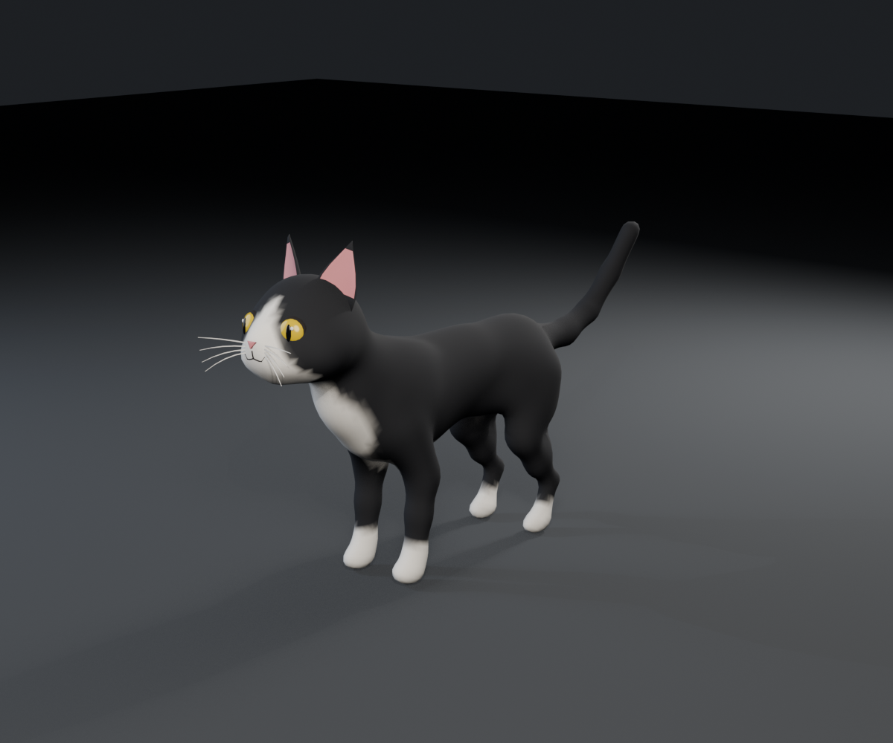
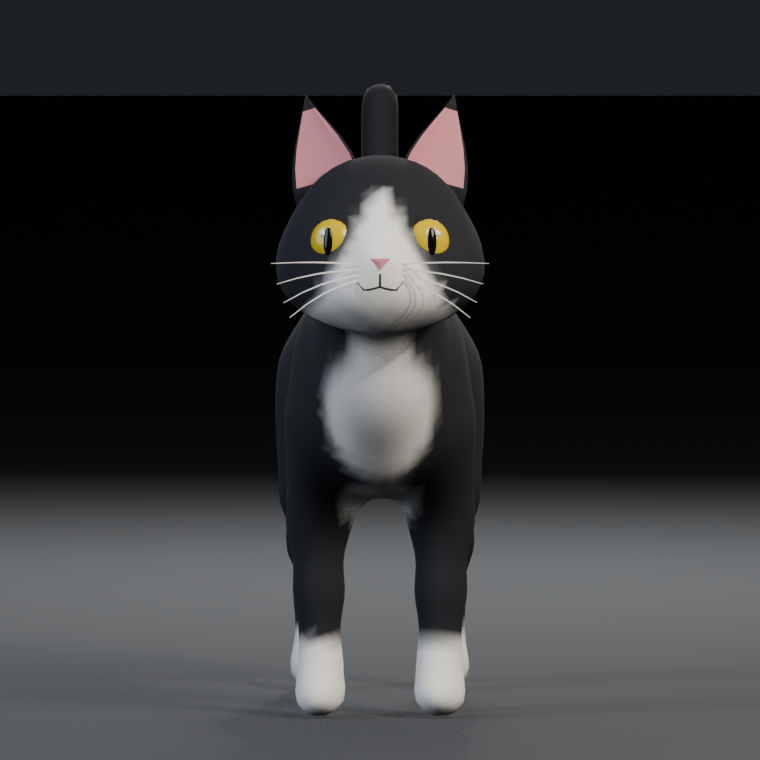
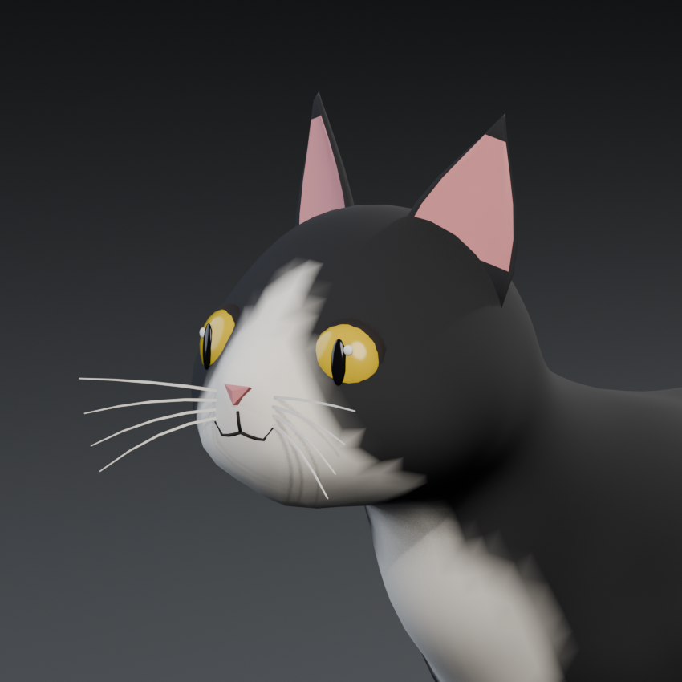
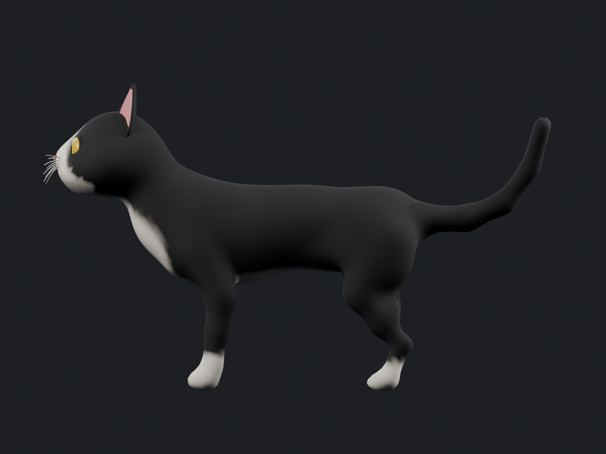

# Tuxedo Cat — low-poly, rigged, animated

A stylised tuxedo cat built in Blender 5.3 from measured photo references, with a
25-bone rig and four game-ready clips: **Idle**, **Walk**, **Run**, **Jump**.



| Front | Head | Side |
|---|---|---|
|  |  |  |

## Specs

| | |
|---|---|
| Bounds (rest pose) | 0.16 m wide × 0.76 m long × 0.47 m tall (tail up) |
| Shoulder height | ~0.32 m |
| Nose to tail base | ~0.57 m |
| Triangles | 12,210 (9,454 fur body + 2,756 face details) |
| Vertices | 6,151 |
| Materials | 7, no textures; the tuxedo markings are vertex colours (`COLOR_0`) |
| Rig | 25 bones: `Root` + 24 deform bones, at most 4 influences per vertex |
| Frame rate | 24 fps |
| Forward | −Y in Blender, +Z in glTF |

## Anatomy (v3, from references)

The v3 rebuild compares the cat against openly licensed photos and a skeleton (see
`refs/sources.txt`). The measured landmarks are in `blender/cat_spec.py`.

- **Hind legs bend like a cat's.** The femur runs down and *forward* to the knee, and the
  tibia runs down and *back* to a high hock (heel). The old build had a backward knee,
  like a dog's.
- **Torso:** a deep ribcage whose floor is at elbow height, then a narrower waist,
  a tucked belly, rounded haunches and a slight rise over the shoulder blades.
- **Head:** carried above the back on a neck that rises at about 40°. It has wide
  cheeks, a short muzzle with two whisker pads and a chin, and a nose bridge.
- **Eyes:** large and forward-facing (20° outward), set about one eye-width apart.
  Each has a dark rim, a gold iris, a vertical slit pupil and a catch light.
- **Ears:** large, with wide bases, cupped and pink inside, leaning outward from the
  corners of the skull.
- **Paws:** compact and round, about 5 cm long (they were about 9 cm before).
- **Tail:** keeps its thickness to a rounded tip.
- **Markings:** a classic tuxedo. The cap and ears are black. The white areas are an
  inverted-V blaze between the eyes, the muzzle and chin, the throat and chest bib
  (front only, not a collar), a belly strip, front socks to the wrist and white
  hind feet.

The body is a single metaball-sculpted surface (no leg-to-body seams). It is
voxel-remeshed, retopologised with Quadriflow to about 4,700 quads and smooth-shaded.
The face parts (eyes, nose, mouth, whiskers, ears) are placed by ray-casting onto the
skin, so they follow the head shape.

## Animations

| Clip | Frames | Duration | Loop | What it shows |
|---|---|---|---|---|
| `Idle` | 1–97 | 4.0 s | yes | breathing, weight shift, slow head look, tail sway, ear flicks |
| `Walk` | 1–25 | 1.0 s | yes | four-beat lateral walk, in place; knee and hock fold on the hind swing |
| `Run` | 1–17 | 0.667 s | yes | bounding gallop with suspension, in place |
| `Jump` | 1–40 | 1.625 s | no | crouch → launch → tuck at apex → land → recover |

- Loops are authored with the last frame equal to the first, and the GLB clips start
  at `t = 0`.
- A per-frame ground-contact pass keeps the paws on the floor for Idle and Walk and for
  the grounded frames of Jump. Run keeps its suspension. The jump carries its vertical
  motion on the `Root` bone.
- `Walk` and `Run` have no forward translation, so a gameplay controller moves the cat.
- Bone names and roll conventions are unchanged from the earlier builds.

## Files

| File | Use |
|---|---|
| `out/Cat.blend` | final scene, `Idle` active; all clips are in the Action editor and stashed in NLA tracks |
| `out/Cat.glb` | main asset: skinned mesh + 4 animations, metres, vertex colours |
| `out/Cat.roblox.glb` | same asset pre-scaled to 4.5 studs per metre (about 3.4 studs long, 2.1 tall) |
| `out/Cat.fbx` | same rig and clips for DCC/FBX pipelines |
| `out/preview_*.mp4` | 640×640 previews per clip; `preview_all.mp4` is the combined showcase |
| `out/cat_hero.png`, `cat_front.png`, `cat_side.png`, `cat_rear.png`, `cat_head.png` | stills |
| `out/strip_*.png` | 8-frame review sheets per clip |
| `blender/cat_spec.py` | measured anatomy, eye/ear placement, marking shapes, colours |
| `refs/sources.txt` | reference photos, authors, licences and what each was used for |

## Using it

**Blender:** open `out/Cat.blend`, select `CatRig`, and pick an action in
Dope Sheet → Action Editor.

**glTF / three.js / Godot / Unity:** import `out/Cat.glb`. It has one skinned mesh,
one skin and four named animations. The mesh uses vertex colours, so use a material
that supports `COLOR_0` (three.js does by default).

**Roblox:** import `out/Cat.roblox.glb` with the 3D Importer. It is pre-scaled to
**4.5 studs per metre**, the same scale as this repo's house and tree. Use
`CollisionFidelity = Box`. The whiskers are thin geometry, so turn off collision on
them if your importer splits them out.

## Rebuild

The pipeline runs headless (it does not touch a live Blender session):

```powershell
& "C:\Program Files\Blender Foundation\Blender 5.3\blender.exe" -b models/cat/out/Cat.blend --python models/cat/blender/15_build_v3.py -- --review
```

```powershell
& "C:\Program Files\Blender Foundation\Blender 5.3\blender.exe" -b models/cat/blender/cat_v3_mesh.blend --python models/cat/blender/16_rig_anim_v3.py
```

```powershell
& "C:\Program Files\Blender Foundation\Blender 5.3\blender.exe" -b --factory-startup --python models/cat/blender/08_video.py
```

1. `15_build_v3.py` reuses the studio and materials from `Cat.blend` and replaces the cat
   with the v3 body and face parts. It saves `blender/cat_v3_mesh.blend`; `--review`
   also renders check shots.
2. `16_rig_anim_v3.py` builds the rig, skins the cat, generates the four clips,
   ground-clamps them, saves `out/Cat.blend` and exports GLB, FBX and the Roblox GLB.
3. `08_video.py` renders the stills and the PNG sequences. Encode the sequences with
   ffmpeg (`-framerate 24 -i video_frames/<Clip>/%04d.png`). `04_strips.py` +
   `05_make_strips.py` make the review sheets.

Scripts `01`–`03`, `06`, `07`, `09`–`14` are earlier pipelines, kept for reference and
superseded by `15`/`16`.

## Notes / limits

- Smooth-shaded low-poly; no textures, UV maps or blend shapes.
- The colour boundaries are per-vertex, so they are soft rather than razor-sharp.
- FK-only rig (no IK). Paws are counter-rotated to stay level and the root is
  ground-clamped per frame, so paws can slide slightly during stance.
- To change proportions, edit `blender/cat_spec.py` and rerun steps 1–3. The rig is
  built from the same landmarks, so the bones follow the mesh automatically.
